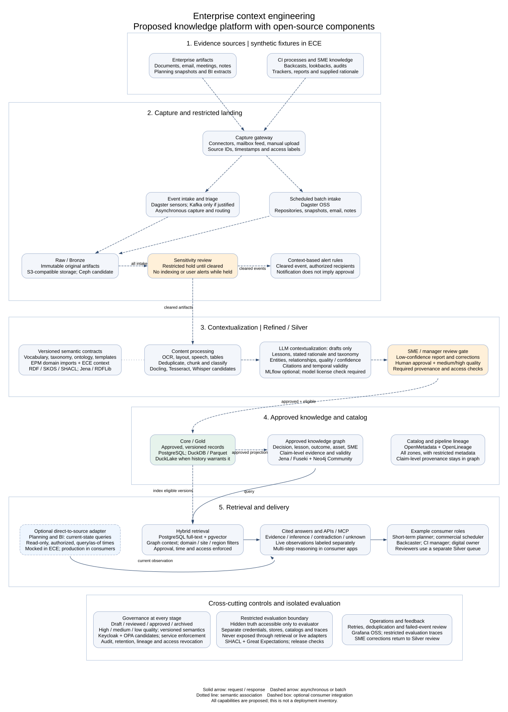

# ECE knowledge platform architecture

Status: Proposed. This diagram describes the target architecture, not deployed services.

The architecture combines the supplied KM baseline with ECE's evidence, provenance, temporal-context and evaluation requirements. Platform components use open-source options. Enterprise products may remain external sources in a downstream deployment; ECE uses synthetic fixtures and mock adapters.



The [editable Graphviz source](source/ece-solution-architecture.dot) is the source of the diagram. Render it from the repository root with:

```sh
neato -n2 -Tsvg docs/architecture/source/ece-solution-architecture.dot -o docs/architecture/ece-solution-architecture.svg
```

Solid arrows show request/response interactions. Dashed arrows show asynchronous or batch transfers. Dotted lines show semantic associations. Event-driven capture can be timely without being synchronous. No latency guarantee is implied.

This is the current proposed architecture view. The earlier CI KM PowerPoint decks and their `.page` sources remain historical discovery artifacts. They describe a client-specific platform and include proprietary products; they are not the current ECE technology recommendation.

## What the baseline adds

The comparison covers the supplied "KM Baseline Architecture Direction" image and comprehensive overview. The [retained reference](source/km-baseline-reference.md) links the original image and quotes the overview's promotion, sensitivity and live-source rules. The earlier [CI KM solution source](source/ci-km-solution-architecture/pages/1_solution_architecture.page) already includes extraction, draft curation, human review, hybrid retrieval, citations, alerts and governance. The additions below make the missing boundaries explicit.

| Baseline capability | Earlier diagram | Updated ECE treatment |
|---|---|---|
| Source systems and CI knowledge | Documents, communications, planning and CI sources already appear. | Group enterprise artifacts separately from backcasts, lookbacks, audits, trackers and SME knowledge. Model them as synthetic evidence in ECE. |
| Capture gateway | Connectors, events, scheduled crawl and upload already appear. | Name mailbox capture, preserve source identity and timestamps, and route both event and batch intake through restricted landing. |
| Event capture and alerting | Event triggers, sensitivity flagging and subscriptions appear separately. | Connect triage, sensitivity hold, clearance, context rules and recipient authorization. Keep notification separate from knowledge approval. |
| Batch intake | Scheduled crawl and immutable landing already appear. | Show planning snapshots, repository sync, archived email/meetings, notes and expert uploads entering Bronze. |
| Semantic foundation | Taxonomy and knowledge graph appear, with Profisee metadata. | Use versioned vocabulary, metadata schemas, SKOS taxonomy, ontology, naming rules and templates. Retain EPM domain imports and ECE context semantics. |
| Content processing | OCR, speech, tables, deduplication and classification already appear. | Separate structural extraction from LLM drafting. Preserve page, table, cell and transcript-time anchors through chunking. |
| Draft contextualization | Extraction, tags, relationships and confidence already appear. | Make Silver drafts explicit. Separate source authority, extraction confidence and evidence status. Require evidence for each rationale. |
| Expert review and promotion | A human gate already appears. | Promote only human-approved records meeting medium/high quality, provenance, schema and access requirements. Low-confidence records remain in the review queue. |
| Medallion storage | Raw landing and a repository appear without explicit tiers. | Name Bronze originals, Silver drafts and Gold approved versions. Treat the tiers as logical contracts independent of a lakehouse vendor. |
| Knowledge graph and catalog | Graph, taxonomy and source links already appear. | Project eligible Gold versions into serving graphs. Separate technical catalog/lineage from claim-level evidence provenance. |
| Live planning and BI | Persistent source links appear, but no live query boundary. | Add an optional read-only adapter with authorization, timestamps and freshness handling. Mock it in ECE. |
| Retrieval and delivery | Search, assistant, APIs/MCP and alerts already appear. | Add explicit access/time filters, separate draft-review reporting, and a consumer boundary for multi-step reasoning and natural-language analytics. |
| Personas | Planning, backcast and leadership groups already appear. | Include short-term planners, commercial schedulers, backcasters, CI managers and digital platform owners. Roles are examples, not ECE account assignments. |
| Governance | Lifecycle, quality, sensitivity, audit and feedback already appear. | Connect these controls to promotion, serving, revocation, retention and isolated evaluation. |

The supplied CI examples are source categories to model, not assertions that ECE has connected those systems. These names follow the supplied image and overview; they do not rename entries in the existing [knowledge-source inventory](../discovery/knowledge-source-inventory.md).

| Category | Examples supplied with the baseline |
|---|---|
| Backcasting | LP Backcast, X/PPIMS, regional analyses; DPO Backcast reports and notes |
| Lookbacks and audits | BWJA Lookback/Jones Act, Gasoline Blending, PMPA post audit, PMDR distribution review |
| Trackers and reports | Value Opp. Tracker, RVCO Value Add, LPO Reports, Weekly Summary |
| SME and working knowledge | Meeting Notes, collaboration calls, supplied SME rationale |

## Data and approval boundaries

Bronze preserves original artifacts and their source identifiers, capture time, source version, content hash and access labels. Event capture and batch capture both land there. Sensitive items remain restricted until an authorized reviewer clears them. Batch intake does not bypass the sensitivity gate. Alerts reveal only information the recipient may access, including titles and source links.

Content processing creates Silver text, tables, transcripts and chunks. LLM contextualization then proposes lessons, taxonomy tags, entities, relationships and confidence assessments. A model can extract rationale supplied by a person or infer a possible explanation with an explicit inference label. It cannot recover undocumented rationale as fact. Missing evidence remains unknown.

Silver is the review workspace. Its contextualized records remain drafts until review finishes. Low confidence routes a record to backcasters, managers or SMEs for correction. A higher model score alone never grants approval. The diagram adopts the baseline's medium/high eligibility rule as a proposed design; scoring thresholds and reviewer assignments remain to be defined.

Gold contains approved versions that pass the eligibility checks. Approval applies to a specific version, its evidence and its semantic contract versions. Corrections create a new draft for review. Revocation, archival or changed access must remove the affected version from serving indexes and graph projections. A graph may retain restricted draft provenance for review, but the assistant's serving graph contains only eligible approved knowledge.

Human approval of a source-derived record does not make every claim in it true. Retrieval preserves contradictory evidence, uncertainty, source authority and validity windows. It distinguishes an approved record from an assertion verified against evidence.

The catalog records artifact and dataset ownership, schema, lineage and access metadata across the tiers. Services and stores enforce permissions on every path. Claim-level citations resolve through the provenance model to a Bronze artifact and precise location; a catalog entry alone is not sufficient evidence.

## Delivery and live-source queries

Ordinary search and cited answers use eligible Gold records, approved graph projections and permission-filtered indexes. Filters include domain, site/region, category, lifecycle and the requested time. Review reporting uses a separate authorized Silver path. It exposes low-confidence drafts to reviewers without adding them to general search, assistants or subscriptions.

The optional direct-to-source adapter queries current planning or BI state without bulk copying the source system. It records query time, source/as-of time, source identity and any available source version. Responses distinguish these live observations from approved historical knowledge. If a source cannot establish freshness or is unavailable, the answer reports that limit. "Live" does not guarantee a current answer.

Historical questions use the planning snapshots captured into Bronze and their approved evidence products. A present-day source response must not replace evidence available at the time of a past decision. If a live observation becomes evidence for a retained answer or decision, preserve the permitted result or an immutable source-version reference, query provenance and access labels. Review that evidence before promoting it to Gold.

APIs and Model Context Protocol adapters expose the same authorization, citation and temporal contracts. Downstream applications may provide multi-step reasoning and natural-language analytics. ECE supplies their context and evaluation contracts; it does not add an autonomous-agent runtime. Production planning/BI connections and user notifications remain downstream integration work under the [operating model](epm-ece-ppc-operating-model.md).

## Open-source component mapping

The [shared technical foundation](shared-technical-foundation.md) owns the existing technology recommendations. These are capability mappings, not deployment commitments or one-for-one product replacements. New candidates below require implementation and license review before adoption. Model weights need a separate license check even when the serving code is open source.

| Baseline product or function | ECE option | Boundary |
|---|---|---|
| Databricks ingestion and processing | Dagster OSS, DuckDB, PostgreSQL and Python processing | Reuse the proposed foundation. No single component replaces all Databricks services. |
| Delta Lake / medallion storage | S3-compatible objects, Parquet and PostgreSQL; DuckLake when needed | Bronze/Silver/Gold are logical contracts. [Delta Lake itself](https://github.com/delta-io/delta) is also open source, but ECE does not need a second table format by default. |
| Object storage | [Ceph Object Gateway](https://docs.ceph.com/en/latest/radosgw/) as an open-source deployment candidate | Existing docs specify hosted Cloudflare R2 through the S3 API. R2 is not open source. This diagram proposes a portable open-source option; it does not claim a storage migration occurred. |
| Event Hubs / Kafka | Dagster sensors for initial capture; Apache Kafka if durable event streaming is justified | Kafka is already an open-source option. ECE does not need a broker just to replay synthetic event fixtures. |
| AI Foundry extraction services | [Docling](https://github.com/docling-project/docling), [Tesseract](https://github.com/tesseract-ocr/tesseract) and [Whisper](https://github.com/openai/whisper) candidates | Supply document/layout/table extraction, OCR and transcription as separate workers. Preserve source anchors and test each supported format. |
| LLM contextualization / Genie / Copilot | Candidate local inference through [llama.cpp](https://github.com/ggml-org/llama.cpp), with a separately reviewed model | Draft extraction and cited-answer generation need application code and evaluation. Tooling does not establish reasoning accuracy. |
| MLflow | MLflow | Already an open-source option; optional experiment tracking in the foundation. |
| Purview / Cognite semantic functions | Jena/Fuseki, RDFLib, SKOS, SHACL and versioned semantic files | These cover the required semantic functions, not the full feature sets of either product. |
| Neo4j | Neo4j Community plus Jena/Fuseki | Reuse the formal-semantics/operational-traversal split. Check edition limits before choosing permission enforcement or hosting. |
| Unity Catalog / catalog lineage | OpenMetadata and OpenLineage | Catalog and run lineage complement claim provenance. Stores and APIs enforce access. [Unity Catalog also](https://github.com/unitycatalog/unitycatalog) has an open-source project; adopting it is not required. |
| Vector store and hybrid search | PostgreSQL full-text search plus pgvector | Apply access, approval and time filters to lexical, vector and graph results. |
| Entra ID / access policy | [Keycloak](https://github.com/keycloak/keycloak) and [Open Policy Agent](https://github.com/open-policy-agent/opa) candidates | Authentication and policy decisions require enforcement in every API, worker and store path. |
| Power BI low-confidence reporting | A restricted reviewer UI over PostgreSQL; [Apache Superset](https://github.com/apache/superset) if dashboards are needed | Connect reviewers to draft details, correction and approval actions. A chart alone is not a review workflow. |
| Monitoring and evaluation traces | Grafana OSS, Langfuse and optional MLflow | Restrict sensitive traces and keep hidden evaluation data out of shared telemetry. |

## ECE-specific controls retained

ECE builds synthetic evidence and reproducible releases. Every generated artifact carries scenario, seed, generator and release identifiers. Domain meaning comes from versioned EPM imports; ECE adds generic evidence, claim, provenance and temporal semantics. The diagram retains those contracts alongside the baseline's Decision, Lesson, Outcome, Asset and SME entities.

Hidden evaluation truth stays in a separate access boundary. Only the evaluator reads it. Capture workers, models under test, retrieval indexes, serving graphs, catalogs, API/MCP adapters and shared traces must not expose it. Development evaluation and hidden evaluation remain distinct. The evaluator can compare answers with hidden truth and publish permitted aggregate results without returning hidden answers to the answering agent.

SHACL checks semantic constraints; Great Expectations can check structured artifacts and release rules. OpenLineage records pipeline execution. Operational controls include retry/deduplication, failed-event review and pipeline health. These controls support the [charter](../charter.md); this documentation change does not implement or validate the services themselves.
